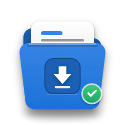

# AppInstall



[](https://github.com/aboodmohd/-AppInstall/releases/latest)

> **[Download the latest stable AppInstall](https://github.com/aboodmohd/-AppInstall/releases/latest).**
> Starting with v1.9.1, the package and command are `abood-appinstall` and
> the desktop ID is `io.github.aboodmohd.AppInstall`. The AppInstall name and
> Premium UI are unchanged. Existing users: [migrate from the legacy package](UPGRADE.md#migration-from-the-legacy-appinstall-package).

A graphical double-click installer for AppImage, Flatpak, DEB, and RPM files on Linux desktops. DEB/RPM applications run in rootless Debian/Fedora Distrobox containers.

**Development status:** tested on CachyOS KDE with selected applications. DEB/RPM compatibility remains application-dependent; some packages omit runtime dependencies or require additional configuration. This project does not guarantee that every Linux package will run.

Install PySide6 for the graphical app preview (for example, `pyside6` on Arch). Without it, KDialog or Zenity provides the confirmation dialog. Flathub previews fetch and cache app names, summaries and icons when online; offline previews use available local information. AppImage details are extracted only after trust confirmation.

Double-click a supported file, review its source and destination, confirm installation, then choose whether to open the application. AppImage downloads are copied into `~/Applications`; the originals remain untouched. Flatpak applications and repositories are installed for the current user.

Managed applications now use monitored launchers. Startup failures show useful errors and logs; open **AppInstall → Application Diagnostics** or run `abood-appinstall --diagnostics` for launch history and safe repair actions. See [Launch Diagnostics](LAUNCH_DIAGNOSTICS.md) for tested behavior and limits.

## AppInstall updates on other Linux distributions (introduced in v1.8.0)

A **portable user-source installation** can now check for future published
stable AppInstall updates and explicitly install a verified source archive
without calling an incompatible host package manager. This is designed to
work wherever the portable Bash/Python/XDG runtime is supported, even
outside Arch, Debian/Ubuntu/Mint and Fedora. An installed native package
keeps its own package-manager update path; missing Qt or backend dependencies
are never installed automatically. See
[Cross-distro update support](docs/CROSS_DISTRO_UPDATE_SUPPORT.md)
for the exact scope, integrity checks and limitations.

## Premium UI/UX (introduced in v1.9.0)

- **My Applications:** one horizontal navigation row (My apps, Discover,
  Updates, Menu, Install app), compact app rows, and separate Installed and
  Needs attention groups with Open or Review actions. Secondary actions live
  in each row's contextual menu; a missing launcher never enables Open.
- **Discover Apps:** prominent search, Flatpak/AppImage/DEB/RPM source tabs,
  responsive catalog cards, source-specific category and sorting controls,
  three-at-a-time Featured pages with keyboard-accessible Previous/Next, and
  preserved View more pagination.
- **Updates:** model-backed summary counts, compact per-app rows and one status
  filter, with the existing opt-in review, cancellation and confirmation rules
  unchanged.
- **Desktop polish:** coherent dark/light palettes, system fonts, reduced-motion
  support, keyboard-accessible controls, and reliable scroll positions and
  gutters across searches, category changes and pagination.

The package installers, review/confirmation safeguards, container backends and
compatibility limits are unchanged. See [RELEASE_NOTES.md](RELEASE_NOTES.md)
for the full release record.

## Discover Apps (introduced in v1.7.0)

**Discover Apps** uses a responsive application-card grid. The **View more**
button reveals additional results in batches of 24 without resetting My
Applications. The catalog limit is 240 per query or collection; upstream
sources may return fewer.

Four searchable formats appear in separate source tabs:

- **Flatpak**: Flathub search and popular-app metadata. Install opens the
  existing HTTPS `.flatpakref` review dialog.
- **AppImage**: a real AppImageHub index. A supported direct HTTPS AppImage
  download goes through the existing review dialog; where there is no
  verifiable direct artifact, **Downloads** opens the AppImageHub page.
- **DEB**: search Debian 13's official APT package index from an
  AppInstall-managed rootless Debian Distrobox container.
- **RPM**: search Fedora 44's official DNF package index from an
  AppInstall-managed rootless Fedora Distrobox container.

**First-time DEB/RPM setup**: choose DEB or RPM, then select **Enable
repository**. A separate explicit confirmation explains that Podman and
Distrobox will create or reuse AppInstall's named rootless container and
download official distribution repository metadata. This may require a large
container image and uses local disk space. Setup does **not** install an
application. Search and browsing results come from the corresponding package manager's
cached repository indexes, not from a hardcoded list of apps. Opening **DEB**
automatically browses Debian APT application-like packages using relevant
package-description metadata. Opening **RPM** browses Fedora DNF packages
providing desktop launcher files, with a repository-name metadata fallback
where filelists are unavailable. These are relevance-ranked browse selections,
not download/popularity rankings. Select **View more** to reveal another 24
results; clearing the search restores browsing. Type two or more characters
to search the full package-name index. App cards
may represent CLI or other non-graphical packages, which will not create
an application launcher after installation.

Selecting **Install** on a DEB/RPM card rechecks the package version and
architecture, displays the existing container package preview, prepares an
APT/DNF transaction for review, and requires another explicit **Install**
confirmation before applying changes. APT/DNF resolve dependencies from
the configured distribution repositories. Package installation remains in
the dedicated rootless container, with AppInstall tracking its managed
record and exporting a desktop launcher if the package supplies one.
Search does not alter packages or run installation scripts. Browsing never creates containers without confirmation and never
requires typing a query once a repository is enabled.

**DEB/RPM application artwork:** app cards initially show a letter placeholder
while genuine package-specific icons are looked up on Debian's public
AppStream service. A matched upstream application's Debian AppStream icon may
also be shown in the Fedora tab; this is artwork only, never package provenance
or an installation source. Official AppStream metadata does not provide
individual application icons for most libraries, documentation, services or
development packages; those cards retain placeholders. The icon lookup is
bounded, cached per session, HTTPS-only, and non-blocking. If AppStream is
unavailable, package search and review continue normally.

**Security and compatibility:** Distrobox integrates with the host home
directory and graphical desktop and **is not a security sandbox**. Only
AppInstall-owned containers with the expected Debian/Fedora image and
validated repositories are used. Not every DEB/RPM package is a graphical
application, compatible with Distrobox, or safe to run. The DEB/RPM first
use requires Podman, Distrobox and related optional tools installed. No
automatic host-native package manager changes are made by Discover.
`My Applications` and the accepted View/Tools/Settings/Help layout remain
unchanged.

v1.7.0, v1.8.0, v1.9.0, v1.9.1 and v1.9.2 are published stable releases. See
[RELEASE_NOTES.md](RELEASE_NOTES.md) for the release history and the current
supported scope.

## Install AppInstall

### Verified native packages

The normal one-command installer still selects an **official native package**
only for the currently verified hosts: Arch Linux/CachyOS, Debian 13,
Ubuntu 24.04/26.04, Linux Mint 22, or Fedora 44. x86_64 is supported on all
of these; native aarch64 (ARM64) is verified on Debian 13, Ubuntu 24.04/26.04
and Fedora 44. It always downloads the **latest published stable** release,
not an unmerged PR or unpublished candidate build. No host package manager is
invoked on an unverified distribution, and no architecture emulation is
enabled. See [Native ARM64 support](docs/ARM64_NATIVE_SUPPORT.md).

### Other Linux desktops — portable source installation

If your distro is not in the native list, AppInstall also has a
**distribution-neutral, non-root source route**, not a falsely renamed
DEB/RPM. Use the verified, published `appinstall-1.9.2-portable.tar.gz`
archive for the current stable portable install:

```bash
sha256sum --ignore-missing -c SHA256SUMS
tar -xzf appinstall-1.9.2-portable.tar.gz
cd appinstall-1.9.2
bash ./install-user.sh
~/.local/bin/abood-appinstall --manage
```

Install Python 3, Bash, freedesktop `xdg-utils`, and for the Discover GUI,
**PySide6 + Qt Quick/QML** from your host's own package manager before running.
Flatpak, Podman and Distrobox are optional for their associated formats.
Portable installation writes AppInstall to your home directory, and detects
native pacman/dpkg/RPM AppInstall packages before adding a potentially
shadowing user copy. The portable archive includes source code, **not**
bundled Qt libraries, universal binaries, or guarantees of compatibility
on every Linux distribution, libc, architecture or desktop session.
For portable removal run `~/.local/bin/abood-appinstall-uninstall`; the
installer preserves managed packages and user data.


**One-command installation** detects the host distribution and architecture
(`x86_64` or `aarch64`; every other machine type is refused). Run this as your normal desktop user (not with `sudo`):

```bash
curl -fsSL https://raw.githubusercontent.com/aboodmohd/-AppInstall/main/install.sh | bash
```

The installer downloads the host-native package and verifies it against
`SHA256SUMS`. Arch Linux/CachyOS use pacman; Debian 13, Ubuntu 24.04/26.04
and Linux Mint 22 use APT; and Fedora 44 uses a native RPM installed
through DNF when the latest published stable release includes that asset.
Ubuntu needs the Universe repository for its Qt bindings. The installer
refuses unsupported distributions rather than reusing another platform's
package.

On APT systems, only the AppInstall `.deb` and its required dependencies
are installed. Optional backends can be installed separately. On Arch and
CachyOS, the installer offers missing optional backends. File association
changes are optional and previous per-user defaults are backed up.

Verify the installation or open the application manager:

```bash
abood-appinstall --version
abood-appinstall --manage
```

The Qt Quick/QML **My Applications** window is the default starting with v1.5.0. For the previous Qt Widgets interface, run
`abood-appinstall --manage --widgets`. Both interfaces use the same managed
application records. Status and Sort controls support keyboard and mouse
selection. The one-command installer always selects the latest *published* stable version,
not a development branch or an unpublished build.

To **uninstall the AppInstall package** and optionally restore previous file associations (your managed applications, containers and user data are preserved), run:

```bash
curl -fsSL https://raw.githubusercontent.com/aboodmohd/-AppInstall/main/install.sh | bash -s -- --uninstall
```

For a no-changes plan, run `curl -fsSL https://raw.githubusercontent.com/aboodmohd/-AppInstall/main/install.sh | bash -s -- --dry-run`. The `--yes` flag allows unattended installation, but does **not** automatically change file defaults; use `--set-defaults` to opt in, or `--no-defaults` to leave them unchanged. See [INSTALL.md](INSTALL.md) for all flags and installation details.

**Fedora 44 support (v1.6.0):** a native RPM and DNF installation path
join the Arch and Debian packages. The installer accepts Fedora 44 on x86_64
and aarch64 only when the **latest published stable release** contains a
matching verified RPM; otherwise it refuses to install. Fedora support is
tested in a disposable CI container; actual GNOME/KDE sessions still require
separate acceptance. See [FEDORA_RPM_ACCEPTANCE.md](FEDORA_RPM_ACCEPTANCE.md).

### Supported architectures by format

| Format | x86_64 host | aarch64 host |
|---|---|---|
| AppInstall native package | `any` (Arch), `all` (DEB), `noarch` (RPM) | same architecture-neutral packages |
| Third-party DEB | `amd64`, `all` | `arm64`, `all` |
| Third-party RPM | `x86_64`, `noarch` | `aarch64`, `noarch` |
| AppImage | ELF machine 62 | ELF machine 183 |
| Flatpak | `x86_64` refs | `aarch64` refs |
| Container DEB/RPM preview | `amd64`/`x86_64`/`all`/`noarch` | `arm64`/`aarch64`/`all`/`noarch` |

Foreign architectures are refused before anything is installed. No QEMU or
binfmt emulation is enabled automatically. Full details and runtime evidence:
[docs/ARM64_NATIVE_SUPPORT.md](docs/ARM64_NATIVE_SUPPORT.md).

For other distributions, see [source installation](INSTALL.md). Installing
DEB/RPM apps inside AppInstall uses Distrobox and is separate from installing
AppInstall itself.

On KDE, GNOME, XFCE, COSMIC, Niri, Hyprland, Sway, and i3, you can
open **My Applications** with `abood-appinstall --manage` and use **Install from
File…**. The file picker works without a desktop portal. File-manager
associations and launcher menus vary by session. CI checks the common X11
and Wayland paths. Individual desktop sessions may need separate testing.

My Applications checks for AppInstall updates while open. When a release is
available, choose **Update AppInstall** and authenticate using your desktop’s
polkit agent. After installation, AppInstall shows the release notes. Reopen
AppInstall to use the new version. On desktops without an authentication
agent, run the terminal installer above.

## Native Debian-family package candidate

The `Debian-family package` GitHub Actions workflow builds an APT-installable
AppInstall package and checks Debian 13, Ubuntu 24.04 and 26.04, and Linux Mint
22 in disposable containers. The workflow covers package installation,
reinstallation, removal, and headless Qt windows. Desktop integration and
full application lifecycle testing require a real desktop session.

For testing, download and extract the `appinstall-deb-…` artifact from a
successful workflow run. From the extracted directory, run:

```bash
sha256sum -c SHA256SUMS
sudo apt install ./abood-appinstall_*_all.deb
abood-appinstall --version
```

The APT package is removed with `install.sh --uninstall`. Ubuntu users
need the Universe repository enabled. For a minimal manual install, add `--no-install-recommends` to the APT command.

## Install from source (alternative)


```sh
git clone https://github.com/aboodmohd/-AppInstall.git appinstall
cd appinstall
```

Install Python 3 and either **KDialog** (KDE) or **Zenity** (GNOME/Xfce), then run:

```sh
./install-user.sh
```

The My Applications manager watches for external changes to its managed registries and updates its list automatically, generally within a couple of seconds. The installer registers file associations for the current user and saves their previous values. It does not require root. If Flatpak is missing when installing an application, AppInstall offers setup through apt-get, dnf, pacman or zypper with a PolicyKit administrator prompt. Other systems receive manual instructions. Immutable systems need their distribution's own Flatpak setup procedure.

The Arch package can be built with `makepkg`. Package installation registers AppInstall as an available file handler, **but does not automatically make it the default**. In Dolphin, use **Open With → AppInstall** and select it as the default for each desired format. `./install-user.sh` is for **source installs from a checked-out repository**; do not run it from an extracted pacman package. To inspect possible conflicts between source and package installs, run `type -a abood-appinstall` and see [UPGRADE.md](UPGRADE.md).

## Supported files

- `.AppImage`: ELF type 2 images matching x86-64 or ARM64. Creates an application menu entry and attempts icon extraction after approval. If FUSE 2 is not detected, offers an extracted launch copy when extraction succeeds. Passive preview uses `unsquashfs` without running the AppImage; extracted AppImage application code is run only when you choose to launch it. Only install and launch packages from trusted sources.
- `.flatpak`: local bundle. Required runtimes may still need downloading.
- `.flatpakref`: application reference; downloads the application and runtime as needed. Confirmation displays its repository and runtime source.
- `.flatpakrepo`: adds a repository, rather than installing an application.

Local integration is usually quick. Download speed, runtime size, extraction and dependency setup determine total installation time. Application compatibility still depends on the app and host system.

## Install from URL

AppInstall can install applications from a direct HTTPS download URL. Open the **Installed Applications Manager** (`abood-appinstall --manage`), click **Install from URL…**, paste the direct link to the package file, and download it. The download runs in the background with a progress bar (file name, bytes, total size, percentage and speed) and can be cancelled at any time; cancelled downloads remove the partial temporary file and leave installed applications unchanged.

When the download finishes, AppInstall detects the real package format (AppImage, Flatpak, Flatpak reference/repository, DEB or RPM) from the file contents — not blindly from the URL extension — and opens the existing package preview so you can review the source, size, SHA-256 digest and proposed installation method before confirming. The download is never installed automatically.

The downloaded file is then handed to the normal installation backends (AppImage, Flatpak, or DEB/RPM via Distrobox), so all existing preview, confirmation, ownership records, launchers, diagnostics and uninstall behavior apply unchanged.

- Accepts HTTPS only; TLS certificates are verified and are never disabled.
- Localhost, loopback, private, link-local, multicast and cloud-metadata addresses are blocked, and every redirect destination is re-validated (mitigating SSRF and DNS rebinding).
- Downloads are streamed to a private temporary directory with a sanitized filename, a size limit is enforced even without Content-Length, and a SHA-256 digest is computed during transfer.
- The digest is shown for your review; it does not by itself make an application trustworthy. HTTPS protects the transfer, not the origin. Only install applications from sources you trust.

CLI:
```sh
abood-appinstall --install-url https://example.com/releases/application.AppImage
abood-appinstall --yes --install-url https://example.com/releases/application.AppImage
```
`--yes` bypasses confirmation (scripts only). Cancellation with `Ctrl+C` removes the partial download.

## CLI

```sh
abood-appinstall FILE.AppImage
abood-appinstall --diagnostics
abood-appinstall --yes --nolaunch FILE.flatpakref
abood-appinstall --dir ~/Games FILE.AppImage
abood-appinstall --install-url https://example.com/releases/application.AppImage
abood-appinstall --yes --install-url https://example.com/releases/application.AppImage
abood-appinstall --list
abood-appinstall --remove NAME
abood-appinstall --detect FILE
```

`--yes` bypasses confirmation and disables the Open prompt. `--nolaunch` suppresses the Open prompt. `APPINSTALL_APPIMAGES` sets the default AppImage directory. Application menu and icon directories respect `XDG_DATA_HOME`; association settings respect `XDG_CONFIG_HOME`.

Each AppImage receives an independent launcher and payload identity, so images with the same embedded name coexist. Extraction and staging must finish before publication. Launchers preserve embedded application arguments and remain executable after AppInstall is uninstalled. Native Flatpak exports stay live rather than being copied. Unrelated file-manager launchers and payloads are never retired.

## Uninstall and recovery

For installs using the **one-command installer**, use the `curl ... | bash -s -- --uninstall` command in [Install AppInstall](#install-appinstall). It removes the system package and offers to restore your previous MIME defaults without deleting managed applications, containers or user data.

For **source installs** using `./install-user.sh`, run `~/.local/bin/abood-appinstall-uninstall` to remove user registration and restore prior associations if AppInstall still owns them. Installed applications are kept. `abood-appinstall --remove NAME` removes an AppInstall-managed AppImage; use Flatpak or your software center to remove Flatpak apps.

If your file manager opens AppImages directly, use **Open With → AppInstall**, then choose it as the default. Executable handling varies by file manager. After installing Flatpak for the first time, logging out and back in may be needed for its applications to appear in menus.

## Validation

```sh
python3 -m unittest discover -s tests -v
bash -n appinstall install-user.sh
```

Automated tests cover invalid input, cancellation, Flatpak failure reporting, existing applications, association restoration, AppImage replacement/failure, icon installation, argument preservation and interception bypass. Seanime Denshi was also installed from a real AppImage and launched through its generated desktop entry on KDE. Desktop VM testing on Ubuntu/Mint, Fedora, Arch/CachyOS and openSUSE remains required before claiming verified cross-distribution support. GNOME, KDE and Xfce are the intended desktop targets.

## DEB and RPM on CachyOS (container backend)

AppInstall now routes DEB/RPM files to its container workflow on every host;
it never passes these files to CachyOS's package manager. The older
`native_backend.py` is retained for compatibility tests but is not the active
installation path.

Install these **host dependencies** using your software manager:
`podman`, `distrobox`, `libarchive`, `python`, `pyside6`, and `glib2` (GIO).
Rootless Podman must be configured for your user (including subordinate UID/GID
ranges). AppInstall reports missing dependencies rather than installing them
silently. Do not run AppInstall as root.

Double-click a `.deb` or `.rpm`, or run `appinstall /path/to/package.deb`.
Preview shows metadata, available icon, dependencies and the container method.
After approval, AppInstall prepares/reuses `debian-apps` (Debian 13) or
`fedora-apps` (Fedora 44), using official container images. Distrobox
bootstrap installs integration dependencies. Review the resulting APT/DNF
transaction and click Install. Package maintainer scripts run only during the
approved installation. The original download is preserved; the staged input is
hashed before installation.

Only official Debian/Fedora repositories are accepted by the repository guard.
Additional vendor repositories require manual review and are not enabled by
AppInstall. Unknown repositories cause the operation to stop.

Distrobox shares your home and integrates with your desktop. **It is not a
security sandbox.** Only install trusted packages. Drivers, kernel modules,
system services and packages requiring host integration are unsupported. Package
metadata cannot prove a package is safe or compatible.

Package-provided desktop entries are exported with `distrobox-export --app`.
For multiple launchers, choose the primary application. Exported labels omit
the container suffix; unrelated or modified launcher collisions stop export.
CLI-only packages are recorded without a graphical launcher.

Lifecycle commands use a registry key such as `deb:example` or `rpm:example`:

```sh
abood-appinstall --container-info deb:example
abood-appinstall --container-launch deb:example
abood-appinstall --container-remove deb:example
```

Select the same package file again to reinstall; select a newer file to update.
Registry: `${XDG_DATA_HOME:-~/.local/share}/appinstall/containers/registry.json`.
It records source, hash, version, container, desktop entry, exported launcher and
icon ownership, operation status and user-confirmed GUI launch verification.
Persistent containers are retained after package removal. Uninstall preserves
application data and user-modified or unrelated launchers/icons. Dependency
autoremove is not requested.

Failures and interrupted operations are marked `needs-repair`; retry the same
package or use the removal command. Container package transactions are **not
atomic**: dependency or maintainer-script changes may remain after failure.
AppInstall does not claim to roll those changes back automatically. Container
snapshots and arbitrary cross-format app deduplication are not implemented.
Host desktop export conflict recovery restores overwritten launcher content.

### Validation status

Real integration testing on CachyOS KDE now passes for Debian Galculator and
Fedora Character Map: Dolphin double-click, confirmation, dependency resolution,
export, visible GUI launch, reinstall as a new independent record, and uninstall.
The published beta release was qualified with 121 passing automated tests and 10 live acceptance tests on CachyOS KDE. Existing Seanime AppImage and Stremio
Flatpak windows were also visually verified. See [INTEGRATION_TESTING.md](INTEGRATION_TESTING.md)
for exact evidence, tested scope, storage and limitations.

Containers have separate application HOME directories and read-only package
staging. Distrobox still shares host resources, including access to the host
home; it is not a security sandbox. Container initialization and images need
roughly 2.7 GiB for these two environments. First-time setup is substantially
slower than subsequent app installation.

### Rollback of this development change

The source and affected user files were backed up to:
`~/appinstall-backups/20261101-215534/`.
Restore `source/` to `~/appinstall/`, `binary` to `~/.local/bin/abood-appinstall`, and
`installed/` to `~/.local/share/appinstall/` to return to the previous code.
The backup also contains the application-launcher directory and MIME config;
restore individual affected files rather than replacing unrelated later changes.
Real integration testing subsequently created `debian-apps` and `fedora-apps`; see the integration report before removing either. If you later create
containers, uninstall their recorded apps first; remove containers only after
checking their contents. Reverting source code does not undo package transactions.
